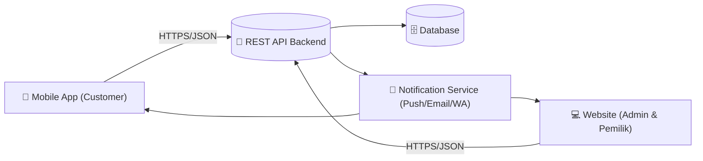

# 🔧 Rancangan Konsep Platform Website & API
### Sistem Informasi Pelayanan dan Penjadwalan Servis Mobil — Bengkel PMM AUTO (Versi Revisi)

**Cakupan:** Website (Admin & Pemilik) · Fokus: Konsep Modul + Endpoint API
**Di luar cakupan:** Aplikasi Mobile (Customer)

> **Catatan cakupan:** Alur/flowchart untuk role **Customer tidak digunakan di website** — role tersebut sudah dan hanya berlaku di aplikasi mobile. Dokumen ini hanya membahas rancangan website (Admin & Pemilik) dan bagaimana konsep **endpoint API** dirancang sebagai jembatan tunggal (single backend) yang menghubungkan input dari aplikasi mobile dengan pemrosesan di website, tanpa website perlu "mengenal" alur UI mobile itu sendiri.

---

## 1. Ringkasan Sistem

Sistem terdiri dari dua platform klien yang berbagi satu backend/API yang sama: aplikasi **mobile** untuk pelanggan, dan **website** untuk admin bengkel serta pemilik. Mekanik tidak memiliki akun/login — seluruh progres pekerjaan mekanik dicatat secara manual oleh admin berdasarkan laporan lisan di lokasi.

| Aktor | Platform | Peran |
|---|---|---|
| 👤 Customer | Mobile saja | Memesan servis, memantau status, upload bukti transfer. Tidak ada akses ke website. |
| 🖥️ Admin Bengkel | Website | Kelola antrian, verifikasi pesanan, tetapkan mekanik, input progres & keluhan, verifikasi pembayaran. |
| 📊 Pemilik Bengkel | Website | Akses laporan produktivitas mekanik & proporsi transaksi non-tunai. |
| 🔧 Mekanik | Tidak ada akun | Berinteraksi dengan sistem hanya lewat laporan lisan ke admin. |

---

## 2. Arsitektur Tingkat Tinggi

Satu backend (REST API) menjadi satu-satunya sumber kebenaran (*single source of truth*) yang diakses oleh kedua platform dengan hak akses (role) berbeda.

Prinsip utamanya: **website tidak menyimpan logika alur customer**. Website hanya membaca/menulis data pesanan, progres, dan pembayaran lewat endpoint API yang sama-sama dipakai bersama mobile, dibedakan lewat token & role.

---

## 3. Struktur Halaman Website (Konsep)

| Halaman | Role | Fungsi Utama |
|---|---|---|
| Login | Admin, Pemilik | Autentikasi & redirect sesuai peran |
| Dashboard | Admin | Ringkasan antrian hari ini, status servis berjalan, notifikasi baru |
| Antrian Pesanan | Admin | List pesanan masuk, approve/tolak, urutan antrian |
| Detail Pesanan | Admin | Data mobil, keluhan, penetapan mekanik, riwayat status |
| Progres & Keluhan Tambahan | Admin | Input progres berdasar laporan lisan mekanik, catat keluhan tambahan |
| Sparepart | Admin | Tambah pemakaian sparepart per pesanan, cek stok |
| Verifikasi Pembayaran | Admin | Cek bukti transfer, ubah status lunas, catat pembayaran tunai |
| Manajemen Slot/Jadwal | Admin | Atur kuota slot servis per tanggal |
| Laporan Produktivitas | Admin, Pemilik | Produktivitas mekanik & proporsi transaksi non-tunai per periode |
| Master Data | Admin | Data mekanik, sparepart, rekening bengkel (opsional) |

---

## 4. Konsep Endpoint API

Semua endpoint berada di bawah prefix versi, mis. `/api/v1/...`, dan dilindungi JWT dengan klaim `role` (`customer`, `admin`, `pemilik`). Endpoint yang sama bisa dipanggil dari mobile maupun website; server yang membatasi hak akses berdasarkan role pada token, bukan berdasarkan platform.

### 4.1 Autentikasi

| Method | Endpoint | Role | Keterangan |
|---|---|---|---|
| `POST` | `/auth/login` | Semua | Login, mengembalikan token + role untuk redirect (mobile vs dashboard web) |
| `POST` | `/auth/logout` | Semua | Invalidasi token |
| `GET` | `/auth/me` | Semua | Ambil profil & role user aktif |

### 4.2 Slot & Jadwal

| Method | Endpoint | Role | Keterangan |
|---|---|---|---|
| `GET` | `/slots?tanggal=YYYY-MM-DD` | Customer | Cek ketersediaan slot (dipakai mobile saat memilih tanggal) |
| `POST` | `/slots` | Admin | Buat/atur kuota slot per tanggal |
| `PATCH` | `/slots/{id}` | Admin | Ubah kuota slot |

### 4.3 Pesanan & Antrian

| Method | Endpoint | Role | Keterangan |
|---|---|---|---|
| `POST` | `/orders` | Customer | Buat pesanan servis baru; server mengurangi kuota slot & menghasilkan nomor antrian |
| `GET` | `/orders?status=&tanggal=` | Admin | Daftar antrian pesanan masuk, dengan filter status untuk dashboard website |
| `GET` | `/orders/{id}` | Admin, Customer (miliknya) | Detail satu pesanan |
| `PATCH` | `/orders/{id}/approve` | Admin | Setujui pesanan |
| `PATCH` | `/orders/{id}/reject` | Admin | Tolak pesanan + keterangan |
| `PATCH` | `/orders/{id}/assign-mechanic` | Admin | Tetapkan mekanik pengerjaan |
| `GET` | `/orders/{id}/queue-number` | Customer | Estimasi nomor antrian (dipakai mobile) |

### 4.4 Progres & Keluhan Tambahan

| Method | Endpoint | Role | Keterangan |
|---|---|---|---|
| `POST` | `/orders/{id}/progress` | Admin | Input status progres berdasarkan laporan lisan mekanik; memicu notifikasi ke customer |
| `GET` | `/orders/{id}/progress` | Admin, Customer | Riwayat status/progres suatu pesanan |
| `POST` | `/orders/{id}/complaints` | Admin | Catat keluhan tambahan yang ditemukan mekanik saat pengerjaan |

### 4.5 Sparepart (Opsional)

| Method | Endpoint | Role | Keterangan |
|---|---|---|---|
| `GET` | `/sparepart` | Admin | Daftar sparepart & stok |
| `POST` | `/orders/{id}/sparepart` | Admin | Tambahkan pemakaian sparepart pada pesanan; server memvalidasi & mengurangi stok |
| `GET` | `/orders/{id}/total` | Admin, Customer | Hitung ulang total biaya setelah sparepart ditambahkan |

### 4.6 Pembayaran (Transfer Manual)

| Method | Endpoint | Role | Keterangan |
|---|---|---|---|
| `GET` | `/orders/{id}/invoice` | Admin, Customer | Lihat tagihan servis |
| `POST` | `/orders/{id}/payment-proof` | Customer | Upload bukti transfer dari mobile |
| `PATCH` | `/orders/{id}/payment/verify` | Admin | Verifikasi bukti transfer, ubah status jadi lunas, memicu pengiriman nota digital |
| `PATCH` | `/orders/{id}/payment/reject` | Admin | Tolak bukti transfer, minta unggah ulang |
| `PATCH` | `/orders/{id}/payment/cash` | Admin | Catat pembayaran tunai langsung di bengkel |

### 4.7 Laporan (Admin & Pemilik)

| Method | Endpoint | Role | Keterangan |
|---|---|---|---|
| `GET` | `/reports/productivity?start=&end=` | Admin, Pemilik | Produktivitas mekanik per periode (Indikator 8.2.1) |
| `GET` | `/reports/non-cash-ratio?start=&end=` | Admin, Pemilik | Proporsi transaksi non-tunai per periode (Indikator 8.10.2) |
| `GET` | `/reports/transactions?start=&end=` | Admin, Pemilik | Rekap transaksi untuk laporan keuangan |

### 4.8 Notifikasi

| Method | Endpoint | Role | Keterangan |
|---|---|---|---|
| `GET` | `/notifications` | Semua | Daftar notifikasi user aktif (polling) atau dipush lewat WebSocket/FCM |
| `PATCH` | `/notifications/{id}/read` | Semua | Tandai sudah dibaca |

---

## 5. Contoh Alur Terintegrasi

### Alur A — Pemesanan hingga Penugasan Mekanik

1. Mobile: `GET /slots?tanggal=` → cek slot tersedia
2. Mobile: `POST /orders` → buat pesanan, server balas nomor antrian
3. Website (Admin): `GET /orders?status=menunggu` → pesanan baru tampil di dashboard
4. Website (Admin): `PATCH /orders/{id}/approve` lalu `PATCH /orders/{id}/assign-mechanic`
5. Server mengirim notifikasi → mobile pelanggan menerima update status

### Alur B — Progres, Keluhan Tambahan, hingga Pembayaran

1. Website (Admin): `POST /orders/{id}/progress` berdasar laporan lisan mekanik
2. (Jika ada) Website (Admin): `POST /orders/{id}/complaints`
3. Mobile: `GET /orders/{id}/progress` → pelanggan pantau status realtime
4. Mobile: `POST /orders/{id}/payment-proof` → unggah bukti transfer
5. Website (Admin): `PATCH /orders/{id}/payment/verify` → status lunas + nota digital terkirim

---

## 6. Pertimbangan Teknis

- **Role-based access control (RBAC):** satu set endpoint, hak akses dibedakan lewat klaim role di JWT, bukan lewat endpoint terpisah per platform.
- **Realtime update ke mobile:** gunakan WebSocket atau push notification (FCM) agar pelanggan "tahu tanpa menelepon" sesuai tujuan flowchart awal.
- **Idempotency:** endpoint approve/reject/verify pembayaran sebaiknya idempoten agar aman dari klik ganda di dashboard admin.
- **Audit trail:** setiap perubahan status (progres, pembayaran) dicatat dengan timestamp & user admin yang melakukan, karena seluruh input berasal dari laporan manual.
- **Versioning API:** gunakan prefix `/api/v1/` agar perubahan di masa depan tidak memutus kompatibilitas mobile atau website.
- **Pemisahan akses upload:** hanya customer yang mengunggah bukti transfer; hanya admin yang boleh mengubah status pembayaran — dijaga di level otorisasi endpoint.

---

## 7. Tahapan Pengembangan Website (Usulan MVP)

1. Autentikasi & manajemen role (Admin, Pemilik)
2. Manajemen slot/jadwal & antrian pesanan
3. Verifikasi pesanan & penugasan mekanik
4. Input progres & keluhan tambahan
5. Pencatatan sparepart (opsional, bisa menyusul)
6. Verifikasi pembayaran manual & nota digital
7. Laporan produktivitas & proporsi non-tunai untuk Pemilik

---

*Dokumen konsep awal — disusun berdasarkan Flowchart Sistem PMM AUTO (Versi Revisi). Detail skema data, format request/response JSON, dan spesifikasi lengkap dapat dikembangkan pada tahap desain teknis berikutnya.*