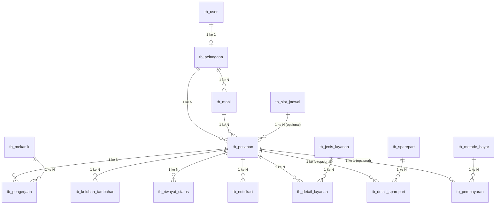

# Konsep Rancangan Basis Data
## Sistem Informasi Pelayanan dan Penjadwalan Servis Mobil — Bengkel PMM AUTO (Versi Revisi)

---

## 1. Latar Belakang & Prinsip Rancangan

Basis data dirancang sebagai **satu kesatuan** yang diakses bersama oleh aplikasi website dan aplikasi mobile melalui **REST API**, sehingga tidak ada duplikasi data antar platform.

Perubahan utama pada versi revisi ini:
- Seluruh tabel diberi awalan `tb_`.
- Akun login untuk mekanik **dihapus** — data mekanik diinput dan dikelola langsung oleh admin.
- Proses pembayaran disederhanakan menjadi **transfer manual**, tanpa payment gateway pihak ketiga.
- Ditambahkan tabel `tb_keluhan_tambahan` untuk menampung temuan baru yang muncul saat pengerjaan berlangsung.

---

## 2. Konsep Entitas Utama

| Kelompok | Tabel Terkait | Inti Konsep |
|---|---|---|
| Pengguna & Kendaraan | `tb_user`, `tb_pelanggan`, `tb_mobil`, `tb_mekanik` | Satu akun `tb_user` dapat berperan sebagai pelanggan, admin, atau pemilik. Mekanik berdiri sendiri tanpa akun login. |
| Pemesanan & Penjadwalan | `tb_pesanan`, `tb_slot_jadwal` | `tb_pesanan` adalah pusat sistem, menghubungkan pelanggan, mobil, dan slot jadwal (slot bersifat opsional untuk pelanggan walk-in). |
| Pengerjaan & Keluhan Tambahan | `tb_pengerjaan`, `tb_keluhan_tambahan`, `tb_riwayat_status`, `tb_notifikasi` | Mencatat proses servis, temuan tambahan, riwayat status, dan notifikasi ke pelanggan. |
| Rincian Biaya | `tb_jenis_layanan`, `tb_detail_layanan`, `tb_sparepart`, `tb_detail_sparepart` | Relasi banyak-ke-banyak antara pesanan dengan layanan/sparepart, diwujudkan lewat tabel penghubung. |
| Pembayaran | `tb_metode_bayar`, `tb_pembayaran` | Setiap pesanan memiliki satu data pembayaran (transfer manual/tunai), diverifikasi oleh admin. |

---

## 3. ERD Relasional — Ringkasan Kardinalitas

**Poin penting:**
- `tb_pesanan` adalah entitas pusat yang menghubungkan hampir semua tabel lain.
- `tb_mekanik` **tidak** terhubung ke `tb_user` (tidak ada akun login mekanik).
- `id_slot` pada `tb_pesanan` bisa `NULL` untuk pelanggan yang datang langsung (walk-in).
- Sparepart bersifat opsional — tidak semua servis memerlukan penggantian sparepart.

---

## 4. Konsep ERD Notasi Chen (Konseptual)

Notasi Chen digunakan untuk pemodelan tingkat konsep (tanpa kunci tamu), dengan kardinalitas format **(min, max)**.

| Simbol | Makna | Contoh Penerapan |
|---|---|---|
| Elips bergaris bawah | Atribut kunci utama | `id_pesanan`, `id_mobil`, dst. |
| Elips garis putus-putus | Atribut turunan (dihitung dari data lain) | `total_biaya` pada PESANAN, `terisi` pada SLOT_JADWAL |
| Persegi panjang ganda | Entitas lemah (bergantung pada induk) | DETAIL_LAYANAN, DETAIL_SPAREPART, KELUHAN_TAMBAHAN |
| Belah ketupat ganda | Relasi pengidentifikasi entitas lemah | Relasi MEMILIKI dari PESANAN ke entitas lemah |
| Garis ganda | Partisipasi total (wajib) | Setiap MOBIL wajib dimiliki PELANGGAN |

**Relasi konseptual kunci:**
- USER —(0,1)— MEMILIKI AKUN —(1,1)— PELANGGAN → tidak semua akun adalah pelanggan.
- PELANGGAN —(0,N)— MEMILIKI —(1,1)— MOBIL → mobil wajib punya satu pemilik.
- PELANGGAN —(0,N)— MENGAJUKAN —(1,1)— PESANAN → pesanan wajib diajukan satu pelanggan.
- SLOT_JADWAL —(0,N)— MENAMPUNG —(0,1)— PESANAN → pesanan boleh tanpa slot (walk-in).
- MEKANIK —(0,N)— DIKERJAKAN —(0,N)— PESANAN → relasi banyak-ke-banyak, dicatat admin (`dicatat_oleh`).
- PESANAN —(1,N)— DICATAT PADA —(1,1)— RIWAYAT_STATUS → setiap pesanan wajib punya minimal satu riwayat status.
- PESANAN —(0,N)— MEMICU —(1,1)— NOTIFIKASI → perubahan status dapat memicu notifikasi.
- PESANAN —(1,N)— MEMILIKI —(1,1)— DETAIL_LAYANAN → setiap pesanan wajib minimal satu layanan.
- PESANAN —(0,N)— MEMILIKI —(1,1)— DETAIL_SPAREPART → sparepart opsional.
- PESANAN —(0,1)— DILUNASI DENGAN —(1,1)— PEMBAYARAN → pesanan boleh belum memiliki pembayaran.

---

## 5. Kamus Data — Ringkasan Tabel

| No | Tabel | Fungsi Utama | Kunci Utama | Kunci Tamu |
|---|---|---|---|---|
| 1 | `tb_user` | Akun pengguna (pelanggan/admin/pemilik) | `id_user` | — |
| 2 | `tb_pelanggan` | Data tambahan pelanggan | `id_pelanggan` | `id_user` |
| 3 | `tb_mekanik` | Data mekanik (tanpa akun) | `id_mekanik` | — |
| 4 | `tb_mobil` | Data kendaraan pelanggan | `id_mobil` | `id_pelanggan` |
| 5 | `tb_slot_jadwal` | Kuota jadwal servis | `id_slot` | — |
| 6 | `tb_pesanan` | Transaksi servis (pusat sistem) | `id_pesanan` | `id_pelanggan`, `id_mobil`, `id_slot` |
| 7 | `tb_pengerjaan` | Catatan pengerjaan servis | `id_pengerjaan` | `id_pesanan`, `id_mekanik`, `dicatat_oleh` |
| 8 | `tb_keluhan_tambahan` | Temuan tambahan saat servis | `id_keluhan` | `id_pesanan`, `ditambahkan_oleh` |
| 9 | `tb_riwayat_status` | Jejak perubahan status pesanan | `id_riwayat` | `id_pesanan`, `diubah_oleh` |
| 10 | `tb_jenis_layanan` | Daftar layanan & tarif | `id_layanan` | — |
| 11 | `tb_detail_layanan` | Rincian layanan per pesanan | `id_detail` | `id_pesanan`, `id_layanan` |
| 12 | `tb_sparepart` | Persediaan sparepart | `id_sparepart` | — |
| 13 | `tb_detail_sparepart` | Rincian sparepart per pesanan | `id_detail` | `id_pesanan`, `id_sparepart` |
| 14 | `tb_metode_bayar` | Daftar metode pembayaran | `id_metode` | — |
| 15 | `tb_pembayaran` | Transaksi pembayaran | `id_pembayaran` | `id_pesanan`, `id_metode`, `diverifikasi_oleh` |
| 16 | `tb_notifikasi` | Notifikasi ke pelanggan | `id_notifikasi` | `id_pesanan` |

---

## 6. Alur Konsep Bisnis Singkat

1. **Registrasi & Kendaraan** — Pengguna mendaftar (`tb_user`), menjadi pelanggan (`tb_pelanggan`), lalu mendaftarkan mobilnya (`tb_mobil`).
2. **Pemesanan Servis** — Pelanggan mengajukan pesanan (`tb_pesanan`), bisa memilih slot jadwal (`tb_slot_jadwal`) atau datang langsung (walk-in).
3. **Pengerjaan** — Admin mencatat penugasan mekanik dan progres (`tb_pengerjaan`), termasuk temuan tambahan (`tb_keluhan_tambahan`) bila ada.
4. **Rincian Biaya** — Layanan (`tb_detail_layanan`) dan sparepart (`tb_detail_sparepart`, opsional) dicatat, lalu dijumlahkan menjadi `total_biaya` pada `tb_pesanan`.
5. **Perubahan Status & Notifikasi** — Setiap perubahan status dicatat (`tb_riwayat_status`) dan dapat memicu notifikasi (`tb_notifikasi`) ke pelanggan.
6. **Pembayaran** — Pelanggan membayar via transfer manual/tunai (`tb_pembayaran`), diverifikasi oleh admin, dengan metode dari `tb_metode_bayar`.

---

## 7. Karakteristik Rancangan yang Menonjol

- **Sentralisasi via `tb_pesanan`**: hampir seluruh proses bisnis (pengerjaan, keluhan, pembayaran, notifikasi, riwayat status) terhubung ke satu titik transaksi.
- **Tanpa akun mekanik**: menyederhanakan keamanan sistem karena semua input mekanik dilakukan atas nama admin (`dicatat_oleh`, `ditambahkan_oleh`, `diubah_oleh` selalu merujuk ke `tb_user`).
- **Fleksibilitas pemesanan**: mendukung baik pelanggan yang menjadwalkan lewat aplikasi maupun yang datang langsung (walk-in), lewat kolom `id_slot` yang nullable dan `kanal_pesan`.
- **Pembayaran manual terverifikasi**: tanpa payment gateway, tetapi tetap ada jejak audit lewat `bukti_transfer`, `status_bayar`, dan `diverifikasi_oleh`.
- **Entitas lemah untuk rincian**: `tb_detail_layanan`, `tb_detail_sparepart`, dan `tb_keluhan_tambahan` tidak punya arti tanpa `tb_pesanan` induknya — sesuai kaidah entitas lemah pada model Chen.
